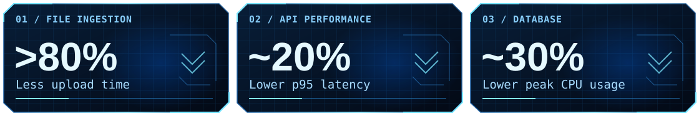

  

  
  
  

## Player status

I'm Satya, a full-stack developer at **Worksoft** in Hyderabad. I build web interfaces with **Angular**, backend services with **C#/.NET**, and data workflows with **SQL Server** and **Python ETL**.

## Worksoft mission report

## Quest log

  
  

## System files

<strong>01 · Skill tree</strong> — current stack and earlier projects

| Branch | Tools |
| :--- | :--- |
| Backend | C#, .NET |
| Frontend | Angular |
| Data | SQL Server, Python ETL |
| Earlier projects | React, JavaScript, MERN, Flutter, Dart, Java for Android |

<strong>02 · Player archive</strong> — education and earlier work

- B.Tech in Computer Science and Engineering.
- Freelance mobile development with Flutter and Dart.

<code>◇ SYSTEM ONLINE ◇</code>

