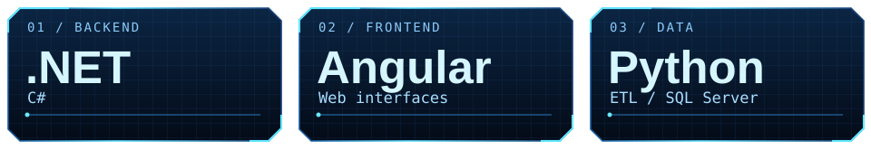

  

  
  
  

## Player status

I'm Satya, a software developer at **Worksoft** in Hyderabad. My background spans web applications and cross-platform mobile development. I enjoy building across the stack, from the interface people use to the services behind it.

  

## System notifications

<strong>01 · Quest log</strong> — explore my projects

- **GamerStreet** · An esports platform I helped build. [View repository](https://github.com/sathya991/Gamer-Street)
- **React Portfolio** · A portfolio project built with React. [View repository](https://github.com/sathya991/React_Portfolio)
- **Pokédex** · A Pokémon catalog project. [View repository](https://github.com/sathya991/Pokedex)

<strong>02 · Skill tree</strong> — expand my development toolkit

| Branch | Tools and systems |
| :--- | :--- |
| Web | React, JavaScript, MERN |
| Backend | .NET, ASP.NET |
| Mobile | Flutter, Dart, Android development with Java |

<strong>03 · Player archive</strong> — background and earlier work

- B.Tech in Computer Science and Engineering.
- Freelance experience in cross-platform mobile development with Flutter and Dart.

<code>◇ SYSTEM ONLINE ◇</code>

