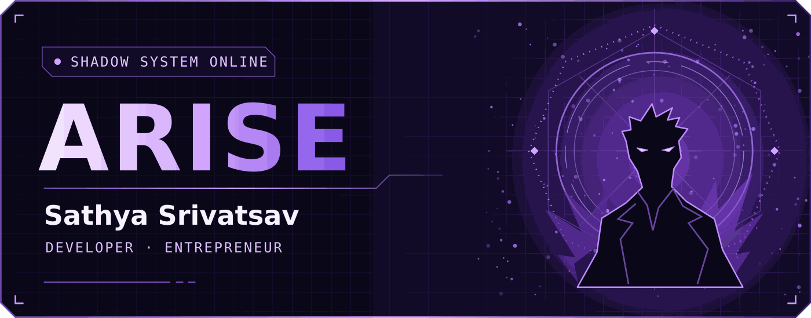
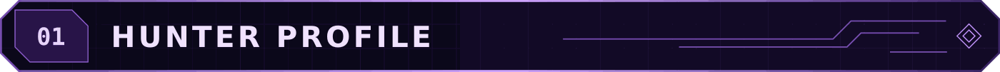
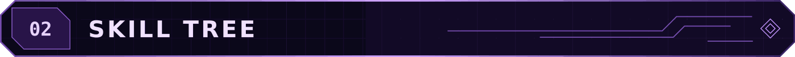
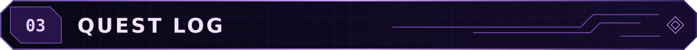

  

  <a href="https://www.linkedin.com/in/satya991/"><strong>Connect on LinkedIn</strong></a>
  &nbsp;·&nbsp;
  <a href="https://github.com/sathya991?tab=repositories"><strong>Browse repositories</strong></a>

  

I'm Sathya, a developer, React designer, and entrepreneur with a B.Tech in Computer Science and Engineering. I enjoy building across the stack, from React interfaces to .NET backends, and I've explored Android development and machine learning along the way.

  

| Branch | Skills |
| :--- | :--- |
| **Frontend** | React, JavaScript, interface design |
| **Web and backend** | MERN stack, ASP.NET, .NET |
| **Mobile** | Android development with Java |
| **Exploration** | Machine learning |

  

- **Build** · Designing and developing web projects with React.
- **Collaborate** · I also take on freelance projects. [Reach out on LinkedIn](https://www.linkedin.com/in/satya991/).

  

